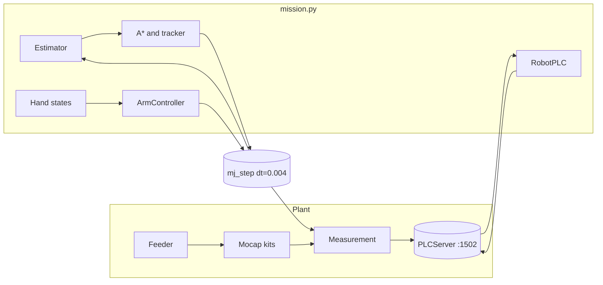

# Advaitic — Robotic Systems Autonomous Packaging Cell

Simulated cell: one Google Robot on a planar mobile base seats ten collar rings on two moving conveyors. The plant measures seating. The robot reports `ASSEMBLY_DONE` and never writes the accepted count.

The committed logs under `results/` are the runs that were checked in. They are not a claim that every machine reproduces those times. See [Known limitations](#7-known-limitations).

## 1. What the code does

One process steps the plant, the robot, and MuJoCo together at `dt = 0.004` s (`integrator="implicitfast"`). A Modbus/TCP test double (`PLCServer`) listens on `127.0.0.1:1502`.

| Piece | Module | Role |
|---|---|---|
| Plant | `plant.py`, `feeder.py`, `frames.py` | Kinematic kits, `seat_verified`, inspection at local x = +0.55 m |
| Mission | `mission.py` | Navigate, dock, hand state machine, PLC commands |
| Arm | `arm.py`, `motion.py` | 7-joint damped least squares, joint-space min-jerk blend |
| Base | `navigate.py`, `scene.py` | A* on a 5 cm map; unicycle tracker on planar slide/yaw joints |
| Sensing | `perception.py` | Odometry, 8-ray scan match, 4 wall ranges, 5×5 wrist rays, 64 human rays |
| PLC | `plc_adapter.py` | Sequence advances only after an acknowledgement |

Customer requirements stay in `docs/CUSTOMER_PACKET.md`, `docs/ACCEPTANCE.md`, and `docs/INTERFACES.md`. This repository's design notes are `docs/SOLUTION.md`, `solution/HLD.md`, `solution/LLD.md`, and `solution/CONSTRAINTS.md`.



Docks in `spec/customer_cell.json` are A `(3.0, 2.0, −π/2)` and B `(3.0, 4.0, +π/2)`. The tracker aims station B 8 mm further in +y. Dock is declared from the pose estimate: within 22 mm and 0.030 rad of the spec dock, and measured base speed at most 8 mm/s.

`READY` is sent after that dock, once the open hand is pre-positioned (`hand_err` ≤ 0.08 m). `_maybe_line_ready` does not send a command. Station B does not release kits until station A has five accepts.

## 2. Committed logs

Times below are the committed `summary.json` / `events.jsonl` values, rounded. Cycle time is `seat_verified.t − kit_arrived.t`.

| Run | Sim time | Wall time | Accepted | Slowest accepted cycle | Rejected kits |
|---|---:|---:|---:|---:|---|
| nominal seed 0 | 223.50 s | 154.54 s | 10 / 10 | 11.980 s | none |
| nominal seed 1 | 249.00 s | 145.92 s | 10 / 10 | 10.208 s | 203, 205 |
| nominal seed 2 | 223.80 s | 134.82 s | 10 / 10 | 9.988 s | none |
| human stop seed 0 | 319.44 s | 339.25 s | 10 / 10 | 9.228 s | 101 (abandoned), 102, 104, 107, 108, 109, 204 |
| PLC retry seed 0 | 223.50 s | 166.91 s | 10 / 10 | 11.980 s | none |

On those logs, `seat_verified` radial error is 3.05–3.28 mm and tilt is 0.0002–0.054 rad. `belt_contacts` is 0. `trace.json` has `oracle: false`. Nominal and fault missions in the table finish under 270 s and 360 s. Seed 0 and the PLC-retry log each have four accepted cycles between 11.588 s and 11.980 s.

Grasp distances recorded in the five `summary.json` files span −9.44 mm to +2.43 mm. A positive value means the finger and ring geoms were not overlapping when the weld engaged.

## 3. Documents and figures

- [docs/SOLUTION.md](docs/SOLUTION.md) — controller behaviour, committed metrics, assumptions, limitations
- [solution/HLD.md](solution/HLD.md) — modules, states, Modbus map, human stop
- [solution/LLD.md](solution/LLD.md) — IK, hand thresholds, navigation, video path
- [solution/CONSTRAINTS.md](solution/CONSTRAINTS.md) — limits that the code and the spec actually use
- [docs/PROVENANCE.md](docs/PROVENANCE.md) — starter package and vendored meshes
- `solution/diagrams/` — architecture, state machine, hand sequence, video path
- `solution/perception/` — offline RGB, segmentation, and depth frames from `scripts/capture_perception_evidence.py`. The live controller does not consume those images. It uses the rays in `perception.py`.

## 4. How to run

Portable path, from a checkout with `uv` and the committed `uv.lock`:

```sh
uv sync --locked --group dev --group physics
uv run pytest -q
uv run ruff check .
uv run systems-timing
uv run python -m advaitic_systems.parts
uv run cell-run --scenario nominal --seed 0 --headless --no-record
uv run cell-eval results/nominal-seed-0/events.jsonl --scenario nominal
uv run cell-run --scenario human_stop --seed 0 --headless --no-record --duration 3 --interrupt-at transfer
uv run cell-eval results/human-stop/events.jsonl --scenario human_stop
uv run cell-run --scenario plc_retry --seed 0 --headless --no-record
uv run cell-eval results/plc-retry/events.jsonl --scenario plc_retry
```

`--interrupt-at` accepts only `transfer`. Video needs `ffmpeg`. When `ffmpeg -encoders` lists `h264_nvenc`, the writer uses it; otherwise it uses `libx264`. Frames are 1920×1080 raw RGB.

```sh
uv run cell-run --scenario nominal --seed 0 --headless --fps 30 \
  --video results/demo/full-mission.mp4 --out results/nominal-seed-0
```

On Windows, `scripts/run_gpu.ps1` starts Ubuntu-24.04 under WSL and `scripts/run_gpu.sh`, which expects Python at `/opt/ars-venv`. A launch with no command runs `scripts/probe_gpu_render.py`, and that file is not in the repository. CI (`.github/workflows/checks.yml`) runs the locked sync, ruff, pytest, `systems-timing`, and `advaitic_systems.parts`. It does not run a mission.

The test suite is 47 cases in `tests/`.

## 5. Sensing used by the controller

Pick (`hover`, `descend`, `close`) aims with the conveyor encoder (±0.2% scale) and a 5×5 downward ray ROI, then clamps that point to ±5 mm of the encoder prediction.

From `carry` onward, bottle motion comes from the plant carrier's arrival time and belt speed. Seat checks, place trim, and the place target read the ring body's simulator pose (`data.xpos`). Weld selection calls `Plant.closest_ring()`, which uses `mj_geomDistance`. Scored runs leave `--oracle-perception` off; that flag is a separate debug path. The placement reads above still use plant state when the flag is off.

Human rays are cast from `_work` when the scenario is `human_stop` and the scripted person has started. A stop starts only if a job is active. The rays originate at the base origin, z = 0.6 m. A geom whose name starts with `human` counts when the range is under 1.0 m, or when the hit lies in the station aisle rectangle.

## 6. Grasp release

The weld stays active while the jaws open. It is released when the fingertip gap exceeds 0.090 m and the ring is within the seat gates in `mission.py` (radial under 2.2 mm, height 128–142 mm above the kit top, ring-up cosine above 0.94). Timeout fallbacks at 2.2 s and 2.8 s use looser gates, and the 2.8 s path releases without those gates. Engage requires a closest-ring distance under 16 mm and a gap under 0.11 m, after the `close` state has held tool-down above 0.90 for at least 0.30 s.

## 7. Known limitations

These are properties of this controller and of one independent re-run. No new sweep was added here.

- Committed nominal seeds 0, 1, and 2 use belt speeds 0.033163, 0.033279, and 0.033395 m/s. The customer range is 0.025–0.035 m/s. On a separate Linux machine with MuJoCo 3.8.1 from `uv.lock`, seed 16 (25.015 mm/s) reached the 270 s cap with 6/10 accepted (7 seated, slowest seated cycle 12.31 s, kits 103, 104, and 202 rejected). Seed 102 (34.967 mm/s) reached the cap with 8/10 accepted (16 arrived, 9 seated).
- That same re-run of nominal seed 0 matched station A and recorded 12.036 s for kit 201, which misses the 12 s cycle cap. The committed log has 11.980 s for that kit. Repeated runs are not bit-identical across machines.
- Human detection does not run during navigation. The stop writes saved joint positions back after `mj_step`. `human_enter` and `stop_command` share one timestamp in the committed human-stop log (t = 35.928 s).
- A lost-ack retry exists only for the first `ASSEMBLY_DONE` when the scenario is `plc_retry`. Other commands use one `PLCClient` request (2 s socket timeout) and no reconnect loop.
- There is no full-mission test. CI does not run `cell-run`.

## 8. Licence

- Google Robot: MuJoCo Menagerie, commit `98a70c569c4c1b6da467a20012f766ee1f8dc521`, Apache-2.0.
- Starter package `src/advaitic_systems/`: Apache-2.0.
- Person mesh: Unitree G1 stand pose from the same pin, BSD-3. See `docs/PROVENANCE.md`.
