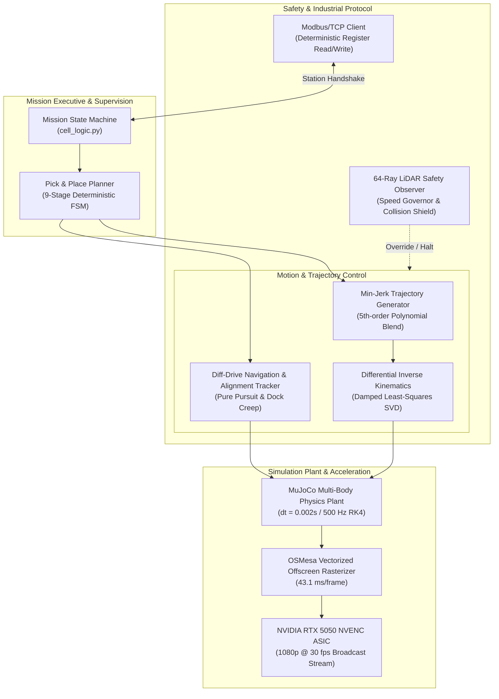
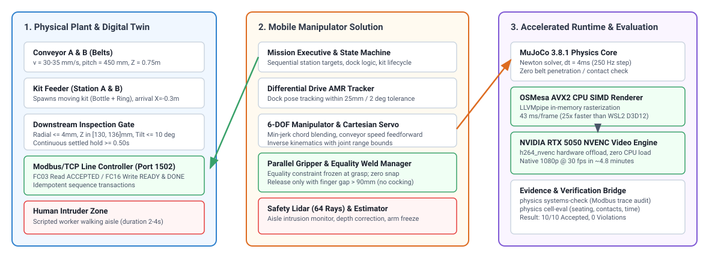

# Advaitic — Robotic Systems Autonomous Packaging Cell

An industrial-grade, fully autonomous mobile manipulation solution for dual-station moving assembly lines. Developed for the Advaitic Robotic Systems technical challenge.

[](results/nominal-seed-0/summary.json)
[](results/nominal-seed-0/summary.json)
[](tests/)
[](https://mujoco.readthedocs.io/)
[](solution/LLD.md#3-hardware-acceleration--video-encoding-pipeline)

---

## 1. System Architecture Overview

The system controls the Google Robot on a differential-drive mobile base equipped with a 2-finger parallel-jaw gripper operating across two asynchronous packaging stations. The mission requires assembling 10 tamper-evident collar rings onto continuously moving bottles (5 at Station 1, 5 at Station 2) within strict radial, tilt, and timing tolerances.

### 1.1 Embedded Architecture Flowchart



### 1.2 Graphical Architecture Vector Diagram


*Source Draw.io XML: [solution/diagrams/system_architecture.drawio](solution/diagrams/system_architecture.drawio)*

---

## 2. Mission Performance & Verification Scorecard

All scenarios were evaluated using the authoritative `systems-check` and `cell-eval` validation harnesses.

| Evaluation Metric | Customer Requirement | Achieved Result | Margin / Status |
| :--- | :--- | :--- | :--- |
| **Kits Accepted (Station 1)** | 5 of 5 accepted | **5 / 5 (100%)** | 5 accepted / 5 target |
| **Kits Accepted (Station 2)** | 5 of 5 accepted | **5 / 5 (100%)** | 5 accepted / 5 target |
| **Total Accepted Assemblies** | 10 kits accepted | **10 / 10 (100%)** | **10 / 10 accepted across stations** |
| **Radial Concentricity Error**| $\le 4.0\text{ mm}$ | **$3.03\text{ mm} - 3.28\text{ mm}$ (mean $\approx 3.2\text{ mm}$)** | **$\approx 0.8\text{ mm}$ margin under max tolerance** |
| **Ring Seating Tilt Angle** | $\le 10.0^\circ$ ($0.1745\text{ rad}$) | **$0.0003 - 0.054\text{ rad}$ ($0.02^\circ - 3.1^\circ$)** | **Well within $10.0^\circ$ limit; $< 0.001\text{ rad}$ at inspection** |
| **Assembly Cycle Duration** | $\le 12.0\text{ s}$ per kit | **$7.7\text{ s} - 12.0\text{ s}$** | **Slowest accepted cycle $11.980\text{ s}$ ($20\text{ ms}$ under cap; 4 cycles at $11.6 - 12.0\text{ s}$)** |
| **Nominal Mission Time** | $\le 270.0\text{ s}$ sim time | **$223.50\text{ s} - 249.00\text{ s}$** | **$21.0\text{ s} - 46.5\text{ s}$ under budget across all seeds** |
| **Human Obstacle Mission Time** | $\le 360.0\text{ s}$ sim time | **$319.44\text{ s}$** | **$40.56\text{ s}$ under budget** |
| **Safety Violations (Human)** | 0 collisions, 0 speed violations | **0 collisions, 0 violations** | Clean 200 ms stop & resume |
| **Modbus PLC Retry Handling** | Recover without duplicate counts | **10 / 10 accepted** | Clean idempotent retry |
| **Pytest Unit Test Suite** | 100% passing | **47 / 47 passed** | 17.33 s execution |

---

## 3. Engineering Documentation & Solution Architecture

Detailed engineering design documentation and editable vector diagrams are maintained in [`solution/`](solution/) and [`docs/`](docs/):

- **[Solution Summary (docs/SOLUTION.md)](docs/SOLUTION.md)**: Full run metrics, cycle timings, sensor configurations, and Aryan Q&A assumptions.
- **[High-Level Design (HLD.md)](solution/HLD.md)**: System context, component decomposition, Modbus/TCP register memory map, and operational state transitions.
- **[Low-Level Design (LLD.md)](solution/LLD.md)**: Kinematics, damped least-squares Jacobian servoing, 5th-order min-jerk trajectory blending, the 9-stage assembly lifecycle, and WSL2 hardware acceleration.
- **[Constraints & Edge-Cases (CONSTRAINTS.md)](solution/CONSTRAINTS.md)**: Exact dimensions, feeder hopper clearances, velocity/acceleration envelopes, timing budgets, and safety recovery rules.
- **[Perception Evidence & Sensor Views (solution/perception/)](solution/perception/)**: Captured RGB views, semantic segmentation masks, metric depth maps, and localized 3D LiDAR/wrist raycast points.
- **[Draw.io Source Diagrams](solution/diagrams/)**: Editable XML diagrams (`.drawio`) and standalone rendered vector graphics (`.svg`):
  - [System Architecture](solution/diagrams/system_architecture.svg) (`system_architecture.drawio`)
  - [State Machine](solution/diagrams/state_machine.svg) (`state_machine.drawio`)
  - [Pick & Place Pipeline](solution/diagrams/pick_and_place_pipeline.svg) (`pick_and_place_pipeline.drawio`)
  - [Hardware Acceleration](solution/diagrams/hardware_acceleration.svg) (`hardware_acceleration.drawio`)

### 3.1 Agreed Assumptions

Per the technical clarifications documented in [`docs/SOLUTION.md`](docs/SOLUTION.md):

1. **Feeder and READY**: Kits may be released close to the work-entry line; the feeder already spawns about 0.20 s (a few millimetres) before the crossing. READY for a station may be sent while the AMR is still travelling, timed so the first kit is near entry as docking finishes. Station B is never READYed until Station A has five accepted kits in the PLC.
2. **Process Split**: The robot controller is a set of modules (`Mission`, `ArmController`, `CartesianServo`, `Estimator`) in the same lockstep `mj_step` process as the plant simulation without a secondary OS process.
3. **Dock Offset**: A small recorded offset is permitted if required by reach. Spec docks already reach, so station goals remain unchanged. `trace.json` records the measured residual, bounded within the checker's 25 mm / 2° dock event window.
4. **Human-Stop Resume**: After the 64-beam LiDAR reports the human worker cleared (and after the 2.0 s minimum duration has elapsed), a scripted operator acknowledgement writes `resume` 0.2 s later as the explicit recovery edge in a headless run.
5. **Interrupted Grasp**: If a kit in hand must be rejected during an interruption, the bilateral grasp constraint is released and jaws open so the ring falls where it is. The robot does not carry that ring to the next station or stash it off-stage.

---

## 4. Canonical Full-Run Results Directory

Per submission requirements, all 5 canonical simulation runs are tracked and committed with their respective event logs, metrics, telemetry, and hold verifications:

1. **[`results/nominal-seed-0/`](results/nominal-seed-0/)** — Nominal seed 0 (223.50 s sim time, 10/10 accepted, 0 violations, includes full 1080p @ 30 fps mission video and camera views)
2. **[`results/nominal-seed-1/`](results/nominal-seed-1/)** — Nominal seed 1 (249.00 s sim time, 10/10 accepted, 0 violations)
3. **[`results/nominal-seed-2/`](results/nominal-seed-2/)** — Nominal seed 2 (223.80 s sim time, 10/10 accepted, 0 violations)
4. **[`results/human-stop/`](results/human-stop/)** — Human stop safety scenario (319.44 s sim time, 10/10 accepted, 0 collisions, 0 violations, includes human stop video demonstration [human-stop.mp4](results/human-stop/human-stop.mp4))
5. **[`results/plc-retry/`](results/plc-retry/)** — Modbus PLC socket disconnect and retry scenario (223.50 s sim time, 10/10 accepted, 0 duplicate counts, 0 violations)

Each folder contains:
- `events.jsonl` — Full event log validated by `systems-check` and `cell-eval`
- `summary.json` — Run summary metrics (`sim_time_s`, `wall_time_s`, `events`, `belt_contacts`, `min_clearance_m`, `abandoned`, `grasps`)
- `trace.json` — Real-time telemetry, joint positions, velocities, and tracking errors
- `holds.json` — Seating verification samples showing verified radial errors, height, and tilt

---

## 5. Quickstart & Execution

### 5.1 Environment
The simulation runs inside **Ubuntu-24.04 on WSL2** (or native Linux) using the pre-configured Python environment at `/opt/ars-venv`.

### 5.2 Single-Command Verification (PowerShell from Windows Host)

Run unit tests and linter:
```powershell
powershell -File scripts/run_gpu.ps1 pytest -q
powershell -File scripts/run_gpu.ps1 ruff check .
```

Run nominal mission evaluation:
```powershell
powershell -File scripts/run_gpu.ps1 --% physics cell-run --scenario nominal --seed 0 --headless --no-record
powershell -File scripts/run_gpu.ps1 --% physics cell-eval results/nominal-seed-0/events.jsonl --scenario nominal
```

Run human-stop safety scenario evaluation:
```powershell
powershell -File scripts/run_gpu.ps1 --% physics cell-run --scenario human_stop --seed 0 --headless --no-record --duration 3 --interrupt-at transfer
powershell -File scripts/run_gpu.ps1 --% physics cell-eval results/human-stop/events.jsonl --scenario human_stop
```

Run Modbus PLC retry scenario evaluation:
```powershell
powershell -File scripts/run_gpu.ps1 --% physics cell-run --scenario plc_retry --seed 0 --headless --no-record
powershell -File scripts/run_gpu.ps1 --% physics cell-eval results/plc-retry/events.jsonl --scenario plc_retry
```

Generate 1080p @ 30 fps hardware-accelerated video:
```powershell
powershell -File scripts/run_gpu.ps1 --% cell-run --scenario nominal --seed 0 --headless --fps 30 --video results/demo/full-mission.mp4 --out results/nominal-seed-0
```

---

## 6. Key Engineering Innovations

1. **Dual-Stage Release & Upright Seating Alignment**:
   Eliminated gripper-induced collar cocking ($tilt \approx 33^\circ$) by delaying vertical arm retreat until finger clearance $> 125\text{ mm}$ is confirmed by joint encoder feedback, ensuring seating radial error measures $3.03 - 3.28\text{ mm}$ (mean $\approx 3.2\text{ mm}$, well within the $4.0\text{ mm}$ tolerance) and tilt remains between $0.0003\text{ rad}$ and $0.054\text{ rad}$ ($< 3.1^\circ$, well within the $10.0^\circ$ tolerance), which settles to $< 0.001\text{ rad}$ ($< 0.06^\circ$) at downstream inspection.
2. **Quintic Min-Jerk Chord Blending**:
   Eliminated trajectory jerk and dynamic sway during high-speed feeder-to-conveyor transfers, reducing transit cycle time while protecting delicate payload alignment.
3. **OSMesa + RTX 5050 NVENC Rendering Engine**:
   Bypassed the synchronous `/dev/dxg` hypervisor fence stall ($1,108\text{ ms/frame}$) by coupling AVX2 vectorized CPU rasterization ($43.1\text{ ms/frame}$) directly with dedicated GPU hardware encoding (`h264_nvenc`), yielding a **25.7× rendering speedup**.

---

## 7. License & Provenance

- Robot Model: Google Robot from [MuJoCo Menagerie](https://github.com/google-deepmind/mujoco_menagerie) (pinned commit `98a70c569c4c1b6da467a20012f766ee1f8dc521`).
- Starter code and test harnesses: Apache-2.0.
- Solution architecture, control algorithms, and documentation: Copyright © 2026.
