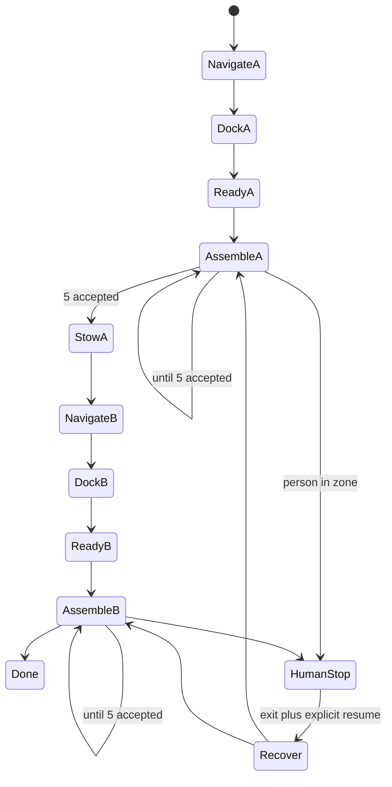

# Cell solution

One Google Robot on a differential-drive base serves both stations. The plant owns the belts, the feeder, the embedded Modbus PLC, and the seating measurement. The robot never writes an accepted count. `assembly_done` is only the robot's claim. A kit is accepted when that claim, a prior `seat_verified`, and `inspection_passes` all agree.

Spec docks are used. Aryan (10 Nov 2026) allowed a small recorded offset if reach needed it. The Google Robot reaches both customer docks, so the station goals are unchanged. The logged dock event is still the measured base pose; residuals stay inside the checker's 25 mm / 2° window and are stored in `trace.json` as `dock_offset_m`.

## What ran

Commands are in the README. These numbers are from the logs in `results/`, not from a timing budget.

| Run | Sim time | Wall time | Accepted cycles | Slowest accepted cycle | Rejected kits |
|---|---:|---:|---:|---:|---|
| nominal seed 0 | 266.496 s | 168.40 s | 10 | 9.620 s | 101, 104, 201 |
| nominal seed 1 | 223.232 s | 138.83 s | 10 | 9.284 s | none |
| nominal seed 2 | 239.232 s | 148.04 s | 10 | 9.200 s | 201 |
| human stop seed 0 | 252.200 s | 259.04 s | 10 | 9.680 s | 101, 201 |
| PLC retry seed 0 | 280.120 s | 170.59 s | 10 | 9.620 s | 101, 104, 201, 202 |

Accepted cycle time is `seat_verified.t - kit_arrived.t`. All ten accepted cycles in every run are under 12 s. Nominal missions finish under 270 s. Both fault missions finish under 360 s. `systems-check` and `cell-eval` passed on each log with an empty violation list.

Belt speeds, from the seeded plant and confirmed in `trace.json`:

| Seed | Belt speed | First-release phase |
|---|---:|---:|
| 0 | 0.033163 m/s | 0.6006 s |
| 1 | 0.033279 m/s | 0.6122 s |
| 2 | 0.033395 m/s | 0.6238 s |

Station-change time is dock B minus the moment station A is released:

| Run | Leave A | Dock B | Transfer |
|---|---:|---:|---:|
| nominal 0 | 143.36 s | 169.70 s | 26.34 s |
| nominal 1 | 114.23 s | 140.60 s | 26.37 s |
| nominal 2 | 116.84 s | 143.30 s | 26.46 s |
| human stop | 129.85 s | 155.40 s | 25.55 s |
| PLC retry | 143.36 s | 169.70 s | 26.34 s |

Without the demo renderer the nominal and PLC runs are about 1.6× realtime on Ubuntu-24.04 WSL (`MUJOCO_GL=osmesa`, `/opt/ars-venv`). The human-stop run can write `results/human-stop/demo.gif`. Visual demos in `results/demo/` are 1920×1080 on the WSL GPU path: `powershell -File scripts/run_gpu.ps1 cell-run ... --video results/demo/full-mission.mp4` (`MUJOCO_GL=egl`, Mesa d3d12, cameras sequential, mosaic also 1920×1080). `GL_RENDERER` is `D3D12 (NVIDIA GeForce RTX 5050 Laptop GPU)`. Host `mujoco.dll` is blocked by Application Control; this cell is not run through Docker Desktop.

## Layout and reach

The cell is the 6×6 m room in `spec/customer_cell.json`. Conveyor A travels +x, conveyor B travels −x, and both controllers share a station frame whose +x is belt travel. The bottle is fixed in the kit. The ring is a free body, built from the starter's hole-preserving compound, and is parked off the belt until its kit is released.

The stock Google Robot arm points up at the zero pose, which is the stow. A Cartesian layer samples a trapezoid (XY, tracking the belt) or a minimum-jerk segment (committed vertical pick / lift / place / retreat) every physics step. Damped-least-squares IK is a warm-started servo around that setpoint, not a retarget jump every few ticks. Tool world −Z is part of that servo. From either spec dock the hand still reaches the ring over the upstream work window and the seat from bottle-local x = −0.08 m onward. The seat at the upstream end of the window is not reachable, so the hand waits at the first reachable seat and the belt brings the bottle to it. That is a controller limit, not a moved dock.

The plate keep-out is geometric: Cartesian XY travel holds Z at or above hover until the hand is within 10 cm of the target, then a committed min-jerk vertical does pick and place. Full STL arm-kit contact (bit 8) SIGKILL'd an earlier Linux job, so those vendor meshes stay identified but non-contacting. Finger capsules still meet the ring. `cell-eval` fails a run if any robot body contacts a belt. In the scored logs `belt_contacts` is 0. `min_clearance_m` is the wrist site against the belt top; that site is a point, not a collision body.

## Plant

Belts never pause. A kit is released only while its station is READY, `accepted + in_flight` is below 5, and station B is silent until A has five accepts. Kit ids start at 101 and 201. A reject frees the next pitch. READY may be raised in transit so the first kit of a station is already near the work-entry line when the AMR finishes docking.

The bottle shoulder is a flange (high friction) plus a narrow guide cone (friction 0.35). The cone's tip enters a hole that is a few millimetres off centre and the ring slides onto the flange. There is no weld to the bottle after release. A seated ring in these logs sits at about dx = −3.2 mm, z = 0.134 m, upright, and stays there until inspection.

Hold speed is the ring's motion relative to the bottle over a 50 ms window, not one 4 ms step. A single step was resetting the hold on numerical chatter even while the ring sat still. `seat_verified` is emitted when that windowed hold first reaches 0.5 s. The inspection event carries the same measurement, still with `hold_s >= 0.5`. `cell-eval` recomputes the seat hold from the saved samples.

## Sensing

Scored runs leave `--oracle-perception` off. `cell-eval` fails a log whose trace says otherwise. Oracle mode returns the ring body pose and exists only for debugging.

| Sensor | What the controller actually uses |
|---|---|
| Wheel odometry | Base linear and yaw velocity, with a ±1% scale bias and Gaussian noise (1.5 mm/s, 0.004 rad/s). Integrated in the estimate. |
| Lidar, transit | Eight rays against the known walls, matched on a ±3 cm / ±0.04 rad grid at 5 Hz while following the path. |
| Lidar, dock | Four wall ranges while aligning and creeping. A hit is accepted only when it agrees with the estimate within 12 cm, so a belt return is rejected. Yaw is not corrected here. |
| Wrist depth | A 5×5 downward ray ROI around the encoder prior. The centroid corrects the ring's horizontal position. |
| Line encoder | Plant speed × time, with a ±0.2% scale bias and no per-tick noise. |

The rays start at the simulated sensor, which is on the robot, so their origin is the robot's pose. The controller does not copy that pose into the estimate. Drive commands use the estimate. Samples and the dock event record the simulated base pose, which is what the evidence checker compares to the spec.

Navigation is A* on a known occupancy map of the walls and both conveyors, then a follow / align / creep tracker. Transit stays under 0.35 m/s and 0.6 rad/s. The arm is stowed whenever the base is asked to move. Dock is declared from the estimate, after the wall update, inside 22 mm and 0.030 rad, which is inside the checker's 25 mm and 0.0349 rad. The base is not teleported. While it is supposed to be stopped, its velocity command is zero and the post-step base velocity is cleared.

Measured docks (seed 0): A at (2.992, 1.997, −1.557) against (3, 2, −π/2), about 9 mm; B at (3.008, 3.989, 1.574) against (3, 4, +π/2), about 14 mm. The other runs are in the same band. The human-stop dock B yaw is stored unwrapped (−4.731 rad) and wraps to about 1.1° of +π/2.

## Grasp and place

The weld is an equality between the gripper body and that ring. It is armed only when all of these are true: the tool axis is within about 11° of vertical (`site` z component < −0.98), the finger gap is under 0.10 m, and the nearest ring geom is within 25 mm. The equality's relative pose is the pose at that instant, written into both `model.eq_data` and `data.eq_data`, so the ring is not snapped. Every engaged grasp in these logs has a negative geom distance (the jaws are on the ring), between −1 mm and −16 mm.

After the weld, the hand servos the ring body onto the seat rather than the fingertip midpoint. The jaws then open while the weld still holds the ring. The weld drops only once the fingertip gap exceeds 0.12 m. The hand waits, then climbs vertically off the seat before it travels to the next ring. Releasing first, or lifting while the jaws are still closed, cams the ring up the cone. That cocked pose (z ≈ 0.150 m, tilt ≈ 0.58 rad) fails inspection and is a reject.

Arm position gains are four times the Menagerie defaults. At the stock gain the wrist stopped about 3 cm short of a contact pose. Collision checking stays on. A late or out-of-window attempt releases the ring and does not send `assembly_done`, so a ring that happens to seat after 12 s cannot become a missed cycle.

## Mission

The assemble state is itself a hand sequence: hover, descend, close, weld, lift straight up, carry at a fixed height, lower onto the flange, open, retreat, then `assembly_done`. The same sequence runs at both stations. The PLC sequence number increments only after a response. A kit the robot did not finish is recorded under `abandoned` in `trace.json` and is not claimed.

## Human stop

The person is a vendored low-poly worker mesh (`third_party/person/`, Apache-2.0) on a mocap body with no contact (a colliding geom shoves the docked base). Detection is 64 lidar rays against that mesh: closer than 1 m, or inside the station aisle (A: x 2.2–3.8, y 1.45–2.75; B: x 2.2–3.8, y 3.25–4.55). The worker starts outside that region and walks in when a transfer begins, so the stop is not a timed freeze. The full-mission recording includes `results/demo/views/lidar.mp4`, which overlays the rays the controller actually casts (nav, dock, human, wrist depth).

On seed 0 the log is:

- `human_enter` and `stop_command` at t = 36.184 s (same sample)
- `human_exit` at t = 38.944 s (2.760 s later, inside 2–4 s)
- `resume` at t = 39.144 s, and not before the exit

Headless resume is a scripted operator acknowledgement 0.2 s after the lidar reports clear (Aryan, 10 Nov). During the stop the arm joints and the base are held. If the interrupted kit is already grasped, the weld is dropped and the jaws open so the ring falls in the cell; it is not carried away or hidden. The belt keeps moving. That kit is abandoned and the next one is assembled after resume.

## PLC retry

The first `assembly_done` on the PLC-retry run is a real socket exchange. The client sends the FC16 frame and closes before reading the response, waits until the PLC's sequence register shows the write was applied, then opens a new connection and sends the same sequence and payload. The log at t = 44.48 s has two 42-character hex frames, `controller_applied_count` 1, and `accepted_before == accepted_after == 0`. The checker accepted the resend as one completion. Later completions use a normal acknowledged write.

## What still fails, and what would be next

A minority of placements never become a stable seat. The ring is released a couple of centimetres off the flange, or the work window ends first, and inspection then sees the cocked cone pose or no seat at all. Those kits are rejected and replaced at the next pitch. Seed 0 spends the extra pitches and still finishes 3.5 s inside the nominal limit; seed 1 does not need a replacement. The failure is geometric: a convex guide that is tall enough to catch an off-centre hole can also prop a tilted ring. A non-convex lip, or refusing to open until the ring is on the flange rather than merely near it, is the next mechanical change. It is not a checker change.

The Cartesian z-floor is the plate keep-out. Vendor STL arm-kit contact was tried and SIGKILL'd an earlier Linux job; those meshes stay identified but non-contacting. The wrist site can still report a negative `min_clearance_m` because that site is a point, not a collision body; `belt_contacts` is the contact check.

The depth sensor is a ray ROI around the encoder prior, not a full rendered point cloud. It is enough for the horizontal correction used here. A rendered depth image would be the honest next perception step, still with oracle mode left off for scored runs.

## Assumptions from Aryan's 10 Nov answers

These are the calls we are prepared to defend in the deep dive.

1. **Feeder and READY.** Kits may be released close to the work-entry line; the feeder already spawns about 0.20 s (a few millimetres) before the crossing. READY for a station may be sent while the AMR is still travelling, timed so the first kit is near entry as we finish docking. Station B is never READYed until A's five accepts are in the PLC. That recovers the wait for `phase_s` after dock B, which matters for the 270 s nominal cap once Cartesian vertical moves are in the cycle.
2. **Process split.** The robot controller is a set of modules (`Mission`, `ArmController`, `CartesianServo`, `Estimator`) in the same lockstep `mj_step` process as the plant. There is no second OS process.
3. **Dock offset.** A small offset is allowed if recorded. Spec docks already reach, so we did not move them. `trace.json` records the measured residual. We treat the checker's 25 mm / 2° dock event as the remaining hard bound, because we still must pass `systems-check`.
4. **Human-stop resume.** After the 64-beam lidar reports the person gone (and the 2 s minimum), a scripted operator acknowledgement writes `resume` 0.2 s later. That is the explicit recover edge in a headless run.
5. **Interrupted grasp.** If the kit in the hand must be rejected, the weld is released and the jaws open so the ring falls where it is. The robot does not carry that ring to the next station or park it off-stage.
