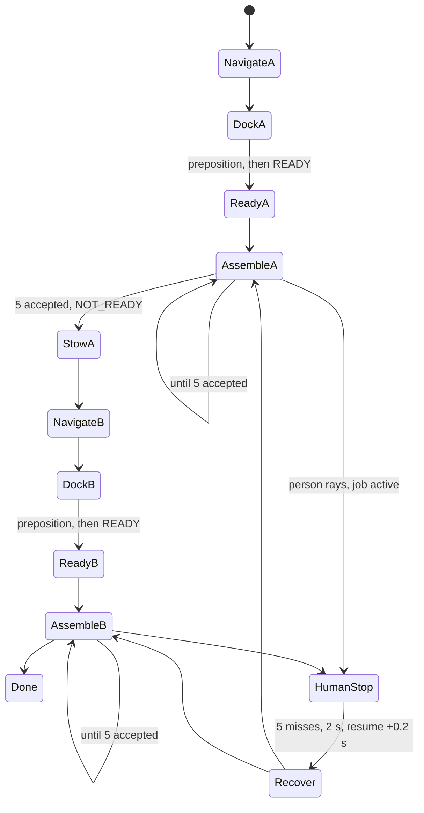

# Cell solution

One Google Robot on a planar mobile base serves both stations. The plant owns the belts, the feeder, the Modbus PLC thread, and the seating measurement. The robot never writes an accepted count. `assembly_done` is the robot's claim. A kit is accepted when that claim, a prior `seat_verified`, and `inspection_passes` all agree.

Spec docks are `(3, 2, −π/2)` and `(3, 4, +π/2)`. The station B tracker creeps to y = 4.008 m. Dock is declared from the estimate against the spec pose (22 mm, 0.030 rad, base speed ≤ 8 mm/s). The logged dock event is the simulated base pose. Residuals are in `trace.json` as `dock_offsets_m`.

## What ran

Commands are in the README. These numbers are the committed logs in `results/`.

| Run | Sim time | Wall time | Accepted cycles | Slowest accepted cycle | Rejected kits |
|---|---:|---:|---:|---:|---|
| nominal seed 0 | 223.50 s | 154.54 s | 10 / 10 | 11.980 s | none |
| nominal seed 1 | 249.00 s | 145.92 s | 10 / 10 | 10.208 s | 203, 205 |
| nominal seed 2 | 223.80 s | 134.82 s | 10 / 10 | 9.988 s | none |
| human stop seed 0 | 319.44 s | 339.25 s | 10 / 10 | 9.228 s | 101 (abandoned), 102, 104, 107, 108, 109, 204 |
| PLC retry seed 0 | 223.50 s | 166.91 s | 10 / 10 | 11.980 s | none |

Accepted cycle time is `seat_verified.t − kit_arrived.t`. In these five logs every accepted cycle is under 12 s. Nominal missions finish under 270 s. Both fault missions finish under 360 s. `belt_contacts` is 0 in each `summary.json`. `cell-eval` recomputes the seat hold from `holds.json`.

Belt speeds, from `scenario_params` and `trace.json`:

| Seed | Belt speed | First-release phase |
|---|---:|---:|
| 0 | 0.033163 m/s | 0.6006 s |
| 1 | 0.033279 m/s | 0.6122 s |
| 2 | 0.033395 m/s | 0.6238 s |

`depart_a_t` is the `NOT_READY` time. `dock_b_t` is the station B dock event:

| Run | Leave A | Dock B | Transfer |
|---|---:|---:|---:|
| nominal 0 | 114.7 s | 141.0 s | 26.3 s |
| nominal 1 | 112.7 s | 139.7 s | 27.0 s |
| nominal 2 | 115.2 s | 141.8 s | 26.6 s |
| human stop | 196.1 s | 223.5 s | 27.4 s |
| PLC retry | 114.7 s | 141.0 s | 26.3 s |

Wall times are the `wall_time_s` column above, from the machines that wrote those logs.

## Layout and reach

The cell is the 6×6 m room in `spec/customer_cell.json`. Conveyor A travels +x, conveyor B travels −x, and both controllers share a station frame whose +x is belt travel. The bottle is fixed in the kit. The ring is a free body of 20 boxes and is parked off the belt until its kit is released.

The stock Google Robot arm points up at the zero pose, which is the stow. Each hand move calls `ArmController.move_down`: damped least squares (damping term `0.04 I` on a 6×7 Jacobian) and a joint-space min-jerk from the previous command to that solution. Tool world −Z is part of that solve. `CartesianServo` is constructed (`vmax_xy = 0.35` m/s, `vmax_z = 0.22` m/s, `amax = 1.2` m/s²) and reset between phases. The hand loop does not step it. From either spec dock the hand reaches the ring over the upstream work window and the seat from bottle-local x = −0.08 m onward. The seat at the upstream end of the window is not reachable, so the hand waits there and the belt brings the bottle to it.

The plate keep-out on the running path is `_chord_clear`: a joint chord whose arm-mesh corners enter a kit box is rejected. `CartesianServo` also has a Z floor while XY error is over 10 cm; the hand loop does not step that servo. Vendor arm STL geoms stay in the model with contact disabled. Finger capsules still meet the ring. `cell-eval` fails a run if any robot body contacts a belt. In the scored logs `belt_contacts` is 0. `min_clearance_m` is the wrist site against the belt top; that site is a point, not a collision body.

## Plant

Belts never pause. A kit is released only while its station is READY, `accepted + in_flight` is below 5, and station B is silent until A has five accepts. Kit ids start at 101 and 201. A reject frees the next pitch. The first arrival is `ready_t + phase_s`. The feeder can spawn up to 0.20 s before that crossing. `READY` is sent from `_work` after the dock and after pre-position (`hand_err` ≤ 0.08 m). It is not sent while the base is in `nav`.

The bottle shoulder is a flange plus a guide cone (friction 0.35). There is no weld to the bottle after release. Across the committed `seat_verified` events the ring's radial error is 3.05–3.28 mm, its centre height is 0.1338–0.1356 m, and its tilt is 0.0002–0.054 rad.

Hold speed is the ring's motion relative to the bottle over a 50 ms window. `seat_verified` is emitted when that windowed hold first reaches 0.5 s and the ring is released. `cell-eval` recomputes the seat hold from the saved samples.

## Sensing

Scored runs leave `--oracle-perception` off. `cell-eval` fails a log whose trace says otherwise. Oracle mode returns the ring body pose from `ring_point` and exists for debugging. Placement does not use that switch. It reads plant state directly, as the last rows of this table.

| Sensor | What the controller actually uses |
|---|---|
| Base velocity | Slide and yaw `qvel`, projected onto the estimated heading, with a ±1% scale bias and Gaussian noise (σ = 1.5 mm/s, σ = 0.004 rad/s). No separate wheel or IMU model |
| Lidar, transit | Eight rays at z = 0.30 m, matched on a ±3 cm / ±0.04 rad grid at 5 Hz while following the path |
| Lidar, dock | Four wall ranges when the tracker is not following the path, including the final dock check. A hit is accepted only when it agrees with the estimate within 12 cm. Yaw is not corrected |
| Wrist depth | A 5×5 downward ray ROI around the encoder prior, used in `hover` / `descend` / `close`. The mission clamps the correction to ±5 mm |
| Line encoder | Plant speed × time, with a ±0.2% scale bias and no per-tick noise. Used for the pick prior and for the stale-kit test |
| Place | `Carrier.arrival_t`, `Carrier.speed`, and the ring `xpos` / `xmat`. `_seat_geometry`, `_update_place_trim`, and `_place_hand_target` all do this |
| Weld | `Plant.closest_ring()`, which calls `mj_geomDistance` |

The rays start on the robot, so their origin is the simulated base pose. The estimate is the integrated, scan-matched state. Drive commands during navigation use the estimate. Samples and the dock event record the simulated base pose.

Navigation is A* on a known occupancy map of the walls and both conveyors, then a follow / align / creep tracker. Commanded transit stays at or below 0.34 m/s and 0.55 rad/s. The arm is stowed whenever the base is asked to move. The base is not teleported. While it is supposed to be stopped, its velocity command is zero and, in `work`, the post-step base velocity is cleared.

Measured docks on nominal seed 0: A `(2.992, 1.997, −1.557)` against `(3, 2, −π/2)`, about 8.5 mm and 0.77°. B `(3.004, 3.997, 1.583)` against `(3, 4, +π/2)`, about 5.2 mm and 0.70°. Estimate-versus-base error at those docks is 2.5 mm and 1.9 mm (`dock_errors_m`). Seed 1 and seed 2 record station B's event yaw unwrapped (about −4.70 rad); the residual stored beside it is the wrapped error.

## Grasp and place

The weld is an equality between `link_gripper` and that ring. `_try_weld` engages when the closest ring geom is within 16 mm and the finger gap is under 0.11 m. The `close` state only calls it after 0.30 s with tool-down above 0.90 and gap under 0.12 m. The equality's relative pose is the pose at that instant, written into `model.eq_data` and `data.eq_data`.

Engaged grasp distances in the five `summary.json` files span −9.44 mm to +2.43 mm (59 grasps). Negative means the finger and ring geoms overlap. Seed 0 includes positive distances (kits 103 and 105, +2.43 mm and +1.15 mm).

After the weld, the hand servos the ring body onto the seat rather than the fingertip midpoint. The jaws then open while the weld still holds the ring. The weld drops when the fingertip gap exceeds 0.090 m and the seat gates pass (radial < 2.2 mm, height 128–142 mm above the kit top, ring-up > 0.94), or on the 2.2 s / 2.8 s fallbacks in `open`. The hand then climbs vertically to 1.005 m before the next approach. Releasing or lifting while the jaws are still closed cams the ring up the cone. That cocked pose (z ≈ 0.150 m, tilt ≈ 0.58 rad) fails inspection and is a reject.

Arm position gains are four times the Menagerie defaults. Collision checking of the finger capsules stays on. A late or out-of-window attempt that does not take the abort-claim path releases the ring and does not send `assembly_done`.

## Mission

The assemble state is the hand sequence in `solution/LLD.md`: hover, descend, close, lift, carry, lower, settle, open, retreat, then `assembly_done`. The same sequence runs at both stations. The PLC sequence number increments only after a response. A kit the robot did not finish is recorded under `abandoned` in `trace.json` and is not claimed, unless `abort` takes the seated claim path and then reports.

## Human stop

The person is a vendored low-poly worker mesh (`third_party/person/`, Apache-2.0) on a mocap body with no contact. Detection is 64 lidar rays against that mesh: closer than 1 m from the base origin, or inside the station aisle (A: x 2.2–3.8, y 1.45–2.75; B: x 2.2–3.8, y 3.25–4.55). `_work` casts them in the `human_stop` scenario after the intruder has started. The stop itself starts only while a job is active. The worker starts outside that region and the script moves it in when a job reaches `lift`. The robot reacts to the rays.

On seed 0 the log is:

- `human_enter` and `stop_command` at t = 35.928 s (same sample)
- `human_exit` at t = 38.500 s
- `resume` at t = 38.700 s

Headless resume is a scripted operator acknowledgement 0.2 s after the clear test passes. During the stop the saved arm, finger, and base positions are written back after each physics step. If the interrupted kit is already grasped, the weld is dropped and the jaws open. The belt keeps moving. That kit is abandoned.

## PLC retry

The first `assembly_done` on the PLC-retry run is a real socket exchange. The client sends the FC16 frame and closes before reading the response, waits until register 1 shows the write was applied, then opens a new connection and sends the same sequence and payload. The log at t = 44.548 s has two 42-character hex frames, `controller_applied_count` 1, and `accepted_before == accepted_after == 0`. Later completions use a normal acknowledged write. Ordinary commands have no retry loop.

## Limitations

Committed nominal runs use seeds 0, 1, and 2 only (33.16–33.40 mm/s). An independent Linux re-run with MuJoCo 3.8.1 from `uv.lock` reported:

- Nominal seed 0: station A matched the committed log. Kit 201 took 12.036 s. The committed value is 11.980 s, so the cycle check fails on that machine.
- Seed 16 at 25.015 mm/s: 6/10 accepted when the 270 s cap was hit. Seven kits seated, slowest seated cycle 12.31 s, kits 103, 104, and 202 rejected.
- Seed 102 at 34.967 mm/s: 8/10 accepted at the cap. Sixteen kits arrived and nine seated.

Placement uses the simulator ring pose and the plant arrival time, including when oracle perception is off. Human detection does not run in `nav`. The lost-ack retry runs once, on the injected fault. CI runs ruff, pytest, `systems-timing`, and the parts check. It does not run `cell-run`.

The depth sensor on the pick is a ray ROI around the encoder prior, not a rendered point cloud. A rendered depth image would replace that ROI. It would also be the way to stop reading `data.xpos` during seating.

## Assumptions from Aryan's 10 Nov answers

These are the calls the implementation follows.

1. **Feeder and READY.** Kits may be released close to the work-entry line. The feeder spawns up to 0.20 s before the crossing. This controller sends `READY` only after docking and pre-positioning, which is later than an in-transit `READY`. Station B is not released until A's five accepts are in the PLC.
2. **Process split.** `Mission`, `ArmController`, `CartesianServo`, and `Estimator` run in the same process as the plant, lockstep with `mj_step`. The PLC server is a thread in that process. There is no second OS process for the robot.
3. **Dock offset.** Spec docks are the acceptance poses. The B tracker goal is 8 mm off in y. `trace.json` records the measured residual of the simulated base. The checker's 25 mm / 2° dock event is the bound `systems-check` applies.
4. **Human-stop resume.** After five ray misses and the 2 s minimum, a scripted acknowledgement writes `resume` 0.2 s later.
5. **Interrupted grasp.** If the kit in the hand must be rejected, the weld is released and the jaws open. The robot does not carry that ring to the next station or park it off-stage.
