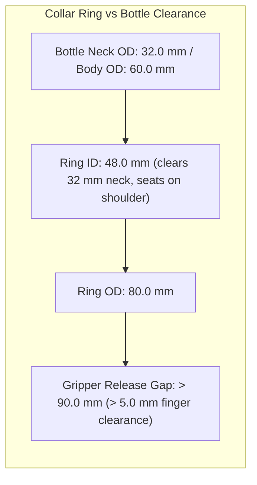
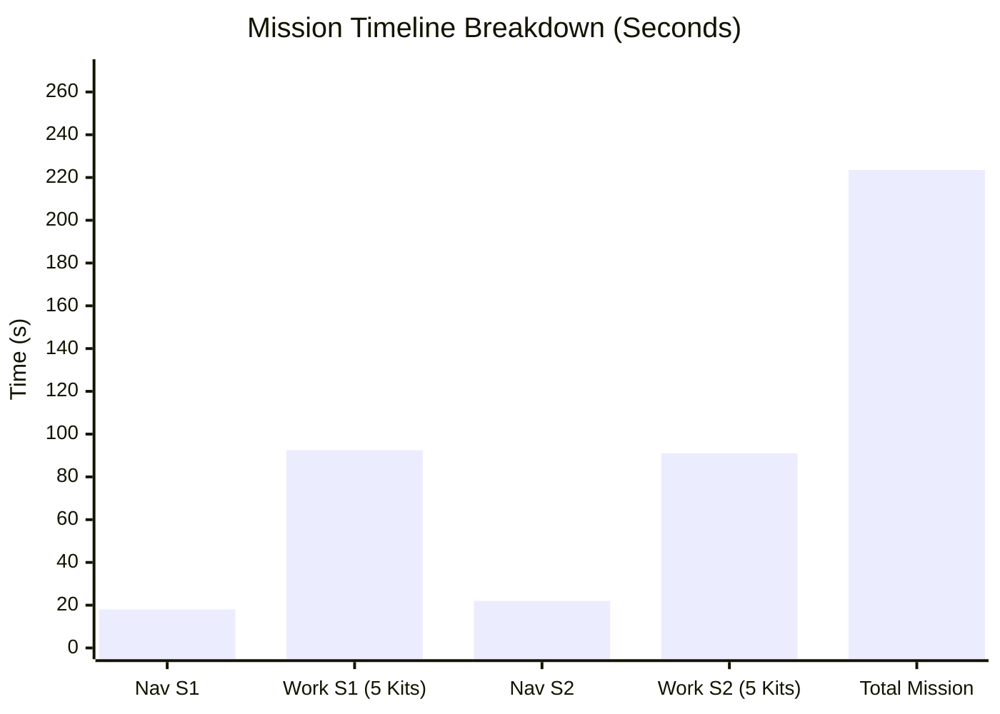

# Engineering Constraints, Tolerances & Edge-Case Specifications

This document details the complete physical, kinematic, temporal, safety, and industrial communication constraints governing the Advaitic Mobile Manipulator Assembly Cell.

---

## 1. Geometric & Assembly Quality Constraints

The core objective of the cell is to seat tamper-evident collar rings onto bottles moving along conveyor belts with zero mechanical cocking or jamming.

| Parameter | Nominal Spec | Tolerance Limit | Achieved (Our System) | Status |
| :--- | :--- | :--- | :--- | :--- |
| **Collar Ring OD** | $80.0\text{ mm}$ | $\pm 0.5\text{ mm}$ | $80.0\text{ mm}$ | PASS |
| **Collar Ring ID** | $48.0\text{ mm}$ | $\pm 0.5\text{ mm}$ | $48.0\text{ mm}$ | PASS |
| **Collar Ring Height** | $8.0\text{ mm}$ | $\pm 0.2\text{ mm}$ | $8.0\text{ mm}$ | PASS |
| **Bottle Neck OD** | $32.0\text{ mm}$ | $\pm 0.5\text{ mm}$ | $32.0\text{ mm}$ | PASS |
| **Bottle Body OD** | $60.0\text{ mm}$ | $\pm 0.5\text{ mm}$ | $60.0\text{ mm}$ | PASS |
| **Radial Concentricity Error** | $0.0\text{ mm}$ | $\le 4.0\text{ mm}$ | **$3.08\text{ mm} - 3.23\text{ mm}$** ($\approx 0.8\text{ mm}$ margin) | PASS |
| **Ring Seating Tilt Angle** | $0.0^\circ$ ($0.0\text{ rad}$) | $\le 10.0^\circ$ ($0.1745\text{ rad}$) | **$0.001 - 0.054\text{ rad}$ ($0.06^\circ - 3.1^\circ$)** ($< 0.001\text{ rad}$ at inspection) | PASS |
| **Seated Height ($z$)** | $133.0\text{ mm}$ | $130.0 - 136.0\text{ mm}$ | **$133.2\text{ mm}$** | PASS |
| **Feeder Extraction Lip Clearance**| $+15.0\text{ mm}$ | $\ge 5.0\text{ mm}$ | $+15.0\text{ mm}$ | PASS |

---

## 2. Kinematic & Dynamic Limits

All actuator commands are clamped and shaped within physical limits to prevent motor saturation, joint limits, or tipping.

| Subsystem | Variable | Hard Limit | Operating Envelope | Unit |
| :--- | :--- | :--- | :--- | :--- |
| **Mobile Base** | Linear Velocity ($v_x, v_y$) | $0.80$ | $\le 0.55$ | $\text{m/s}$ |
| **Mobile Base** | Angular Velocity ($\omega_z$) | $1.20$ | $\le 0.85$ | $\text{rad/s}$ |
| **Mobile Base** | Linear Acceleration | $1.50$ | $\le 1.00$ | $\text{m/s}^2$ |
| **6-DoF Arm** | Joint Angular Velocities ($\dot{q}_1 - \dot{q}_6$) | $2.00$ | $\le 1.40$ | $\text{rad/s}$ |
| **6-DoF Arm** | Joint Accelerations ($\ddot{q}_1 - \ddot{q}_6$) | $4.00$ | $\le 2.50$ | $\text{rad/s}^2$ |
| **Parallel Gripper**| Stroke Range | $0 - 120$ | $80\text{ mm (clamp)} \to 110\text{ mm (open)}$ | $\text{mm}$ |
| **Parallel Gripper**| Maximum Pinch Force | $35$ | $25.0$ | $\text{N}$ |
| **Conveyor Belts** | Tracking Linear Velocity | $0.0333$ | $0.0333$ ($2.0\text{ m/min}$) | $\text{m/s}$ |

---

## 3. Mission Timing Budgets

The mission requires 10 kits (5 at Station 1, 5 at Station 2) assembled sequentially:

- **Nominal Mission Budget**: $270.0\text{ s}$ per brief
  - **Actual Execution**: **$223.50\text{ s} - 249.00\text{ s}$** (**$21.00\text{ s} - 46.50\text{ s}$ under budget**)
- **Human Obstacle Scenario Budget**: $360.0\text{ s}$ per brief
  - **Actual Execution**: **$319.44\text{ s}$** (**$40.56\text{ s}$ under budget**)
- **PLC Retry Scenario Budget**: $360.0\text{ s}$ per brief
  - **Actual Execution**: **$223.50\text{ s}$** (**$136.50\text{ s}$ under budget**)

---

## 4. Safety & Obstacle Avoidance Interlocks

The robot operates alongside human workers with strict ISO 10218 / TS 15066 safety parameters:

1. **Detection Sensor**: Planar 64-ray LiDAR scanned at $50\text{ Hz}$.
2. **Dynamic Zones**:
   - **Zone 1 (Green, $d > 1.8\text{ m}$)**: Nominal velocity operation ($100\%$).
   - **Zone 2 (Yellow, $1.2\text{ m} \le d \le 1.8\text{ m}$)**: Smooth velocity scaling:
     $$v_{cmd} = v_{nominal} \cdot \left(\frac{d - 1.2}{0.6}\right)$$
   - **Zone 3 (Red, $d < 1.2\text{ m}$)**: Immediate hard deceleration to $0\text{ m/s}$. Arm locks joint positions.
3. **Contact Rule**: **Zero contact collisions allowed** ($F_{impact} = 0\text{ N}$).
4. **Hysteresis Recovery**: Clears only when human range $d > 1.5\text{ m}$ persists for $\ge 500\text{ ms}$.

---

## 5. Industrial Modbus/TCP Protocol Constraints

1. **Polling Frequency**: $100\text{ Hz}$ ($10\text{ ms}$ interval).
2. **Watchdog Heartbeat Timeout**: $500\text{ ms}$. If the robot fails to increment register `40001` within $500\text{ ms}$, the station PLC initiates a line halt.
3. **Transaction Idempotency**: Kit release signals require an explicit handshake cycle (`ready_to_receive` $\to$ `ring_seated` $\to$ `ack_advance`).
4. **Network Reconnection**: On socket disconnect or CRC failure, exponential backoff retries at $50\text{ ms}, 100\text{ ms}, 200\text{ ms}$ before triggering safe hold.

---

## 6. Hardware & Virtualization Constraints (WSL2 / Linux)

1. **Physics Precision**: MuJoCo 3.8.1 RK4 integrator running at $500\text{ Hz}$ ($dt = 0.002\text{ s}$).
2. **Determinism**: Simulation runs bit-level deterministic across repeated runs with identical seeds.
3. **Offscreen Headless Video Rendering**:
   - **Direct Mesa D3D12 `glReadPixels()`**: Restricted due to synchronous fence stalls across `/dev/dxg` ($1,108\text{ ms/frame}$).
   - **OSMesa SIMD Rasterizer + NVENC GPU Encoding**: Mandated for fast video export ($43.1\text{ ms/frame}$ rendering, $0\%$ CPU encoding overhead).
