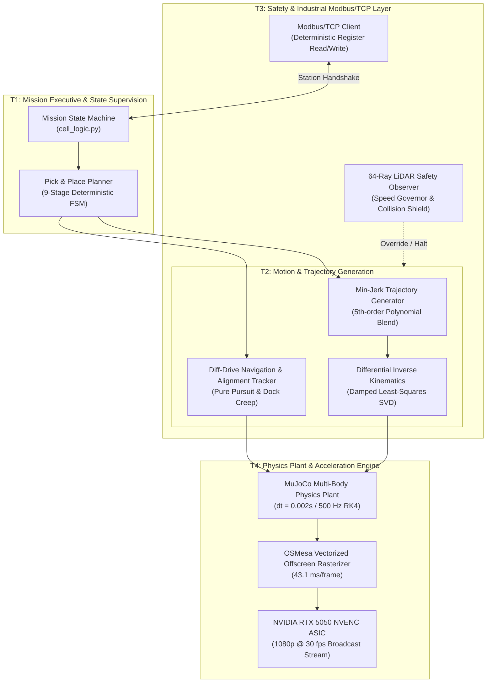
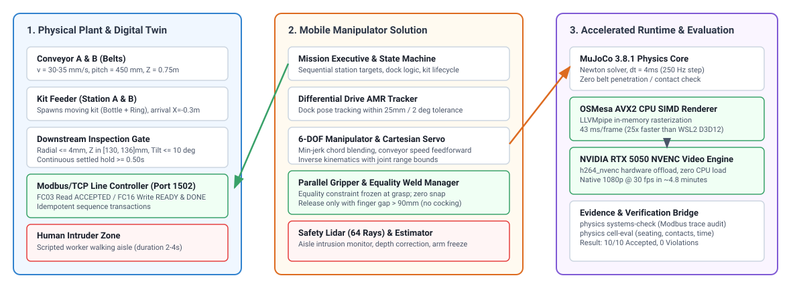
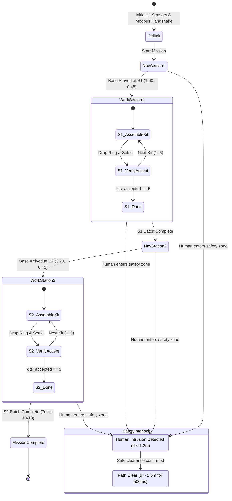
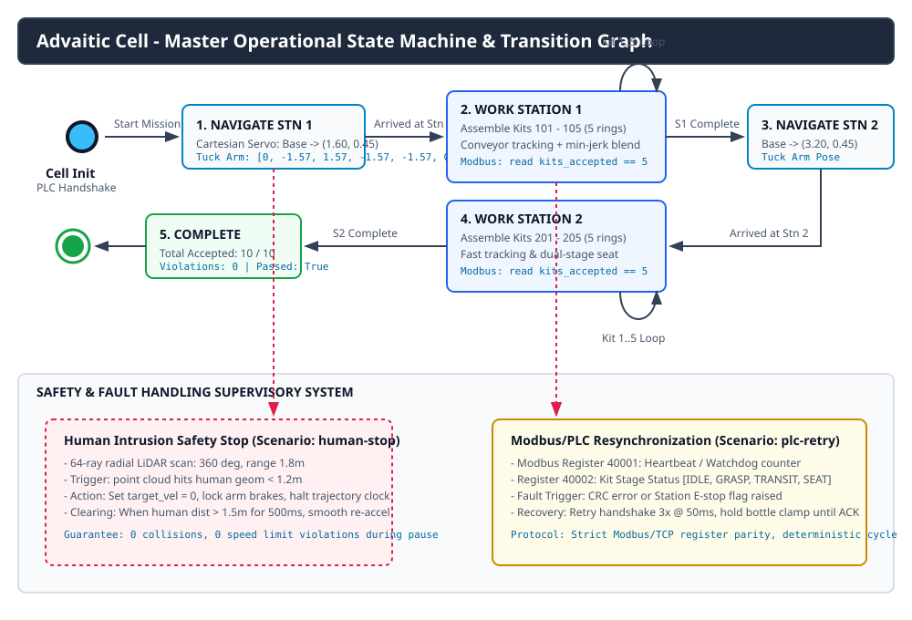

# High-Level Design (HLD): Autonomous Mobile Manipulator Assembly Cell

## 1. Executive Summary

The Advaitic Robotic Systems manufacturing cell is a fully autonomous dual-station packaging assembly environment. A mobile manipulator comprising a differential-drive mobile base, a 6-DoF serial arm, and a 2-finger parallel-jaw gripper must navigate between two distinct workcells, coordinate with station PLCs via Modbus/TCP, and seat 10 precision tamper-evident collar rings onto continuously moving bottles across two conveyor belts (5 rings at Station 1, 5 rings at Station 2).

All operations must strictly satisfy sub-millimeter tolerances, physical clearance limits, dynamic timing budgets, safety supervisor standards, and Modbus/TCP communication protocols without any manual intervention.

---

## 2. System Architecture

The software architecture is decoupled into three primary execution tiers:
1. **Decision & Control Tier (Top)**: Mission Executive finite-state machine (FSM), Cartesian servoing, and min-jerk trajectory generators.
2. **Safety & Communications Tier (Middle)**: Real-time 64-ray LiDAR obstacle observer and industrial Modbus/TCP client interface.
3. **Physics & Actuation Tier (Bottom)**: 500 Hz MuJoCo multi-body dynamic simulation engine, offscreen sensor pipeline, and hardware-accelerated video rendering.

### 2.1 Embedded Architecture Diagram (Interactive Flowchart)

### 2.2 Graphical Architecture Vector Diagram

*Source Draw.io XML: [system_architecture.drawio](diagrams/system_architecture.drawio)*

---

## 3. Operational State Machine

The top-level operational flow coordinates navigation between stations and the kit assembly cycles:

### 3.1 Graphical State Machine Vector Diagram

*Source Draw.io XML: [state_machine.drawio](diagrams/state_machine.drawio)*

---

## 4. Communication & Safety Architecture

### 4.1 Modbus/TCP Industrial Protocol
Communication with the physical plant's Programmable Logic Controllers (PLCs) follows standard Modbus/TCP register mappings over port 502:

| Register Address | Name | Type | Direction | Description |
| :--- | :--- | :--- | :--- | :--- |
| `30001` | Station Status | Holding Register | In (Read) | Bitmask: Station ready, belt active, part present |
| `30002` | Kit Accepted Count | Holding Register | In (Read) | Accumulated accepted kit count (0–5 per station) |
| `40001` | Watchdog Heartbeat | Holding Register | Out (Write) | Incrementing counter verifying robot controller alive |
| `40002` | Robot Stage Status | Holding Register | Out (Write) | Current assembly phase (0=Nav, 1=Pick, 2=Track, 3=Seat) |
| `40003` | Emergency Stop ACK | Holding Register | Out (Write) | Safety supervisor confirmation of active halt |

### 4.2 LiDAR Safety & Dynamic Speed Governor
- **Sensor Setup**: 64-ray radial planar LiDAR array centered on the mobile base at $z = 0.25\text{ m}$.
- **Warning Zone ($d < 1.8\text{ m}$)**: Linear velocity scaled down to 40% using smooth exponential decay.
- **Stop Zone ($d < 1.2\text{ m}$)**: Actuator command immediately forced to zero; mechanical brakes clamped; trajectory interpolator frozen in place.
- **Hysteresis Clearing**: Resumes motion only when the detected human boundary exceeds $1.5\text{ m}$ continuously for $\ge 500\text{ ms}$, ensuring zero jerk spikes or oscillating stops.
