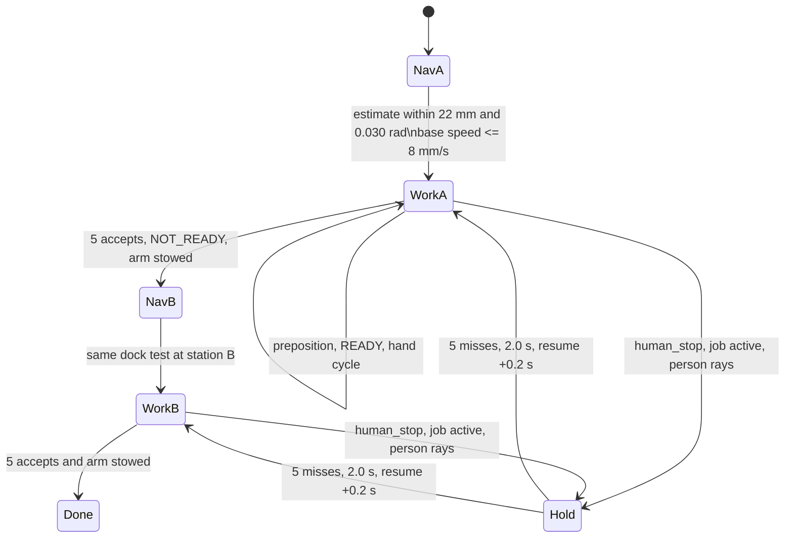

# High-Level Design

One mobile manipulator serves two conveyors in the 6×6 m cell from `spec/customer_cell.json`. The implementation is the package `src/advaitic_cell/`. The customer starter (`src/advaitic_systems/`, `spec/`, `docs/CUSTOMER_PACKET.md`, `docs/ACCEPTANCE.md`, `docs/INTERFACES.md`) is unchanged.

## 1. Runtime

Robot, plant, and physics share one process and one 4 ms step:

1. `Plant.drive` releases kits and moves the kinematic belts.
2. `Mission._step_robot` navigates or runs the hand state machine.
3. `mj_step` integrates with `implicitfast` at `dt = 0.004` s.
4. `Plant.measure` updates the hold and, at local x = +0.55 m, calls the line controller's `inspect`.

`PLCServer` runs on a daemon thread. The robot talks to it with real TCP. The bind address is `127.0.0.1:1502`, or port 0 if 1502 is already taken.

The base is not a wheel model. `scene.py` adds two slide joints and one yaw hinge to the Google Robot and drives them with velocity actuators. `DiffDriveTracker` emits a forward speed and a yaw rate. Those are clipped to ±0.34 m/s and ±0.55 rad/s and written as world-frame slide commands using the estimated yaw. The arm must be at the stow pose (all seven arm joints within 0.22 rad of zero, and not deployed) before the base command is allowed to be nonzero.

The arm joints are `joint_torso`, `joint_shoulder`, `joint_bicep`, `joint_elbow`, `joint_forearm`, `joint_wrist`, and `joint_gripper`, plus two finger joints.

## 2. Mission

`Mission` in `mission.py` is the state machine. There is no `cell_logic.py`.

Spec docks are A `(3.0, 2.0, −π/2)` and B `(3.0, 4.0, +π/2)`, from the start pose `(1.0, 3.0, 0)`. Navigation plans to a point 0.60 m before the dock, follows that path, aligns heading, then creeps. Station B's creep target is the spec dock plus 8 mm in y. The dock event stores the simulated base pose, which is what `systems-check` compares to the spec.

After the dock, the hand moves to station-local x = −0.08 m at z = 1.00 m. `READY` (command 1, kit id 0) is sent when that error is at most 0.08 m. `_maybe_line_ready` is empty. A job starts only when the queue is nonempty and `hand_err` < 0.05 m. Kits whose encoder-predicted bottle x is already past 0.12 m are abandoned and not claimed.

The hand states on a successful kit are `hover`, `descend`, `close`, `lift`, `carry`, `lower`, `settle`, `open`, `retreat`. Thresholds are in `solution/LLD.md`. `ASSEMBLY_DONE` (command 3) is sent in `retreat`, or from `abort` when the ring is already on the flange (`abort-claim`). A plain abort releases the ring, records the kit in `trace["abandoned"]`, and does not send `ASSEMBLY_DONE`.

After five accepts at A the controller sends `NOT_READY`, stows, and plans to B. After five accepts at B it stows and sets `phase` to `done`. The plant refuses station B releases until A has five accepts, even if the robot has sent `READY`.

## 3. Who accepts a kit

`ASSEMBLY_DONE` sets `kit.done` on the line controller. The accepted count increments only inside `LineController.inspect`, when `done` is true and `inspection_passes` holds. That measurement is computed in `Plant._measurement` from ring and bottle geometry and contacts. The robot does not write registers 14 or 24.

`seat_verified` is the plant event that ends the cycle clock: a continuous 0.5 s hold of in-tolerance, settled, released geometry. Relative speed uses a 50 ms window.

## 4. Modbus

The map is the starter contract. Addresses are zero-based. Polling is every 25 steps (100 ms) during `work`. The client reads the latest-arrival register (11 or 21) and the accepted count (14 or 24) and keeps its own kit-id set. There is no watchdog register, no heartbeat write, and no backoff schedule.

| Address | Meaning | Robot |
|---|---|---|
| 0 | Schema version 1 | Read |
| 1 | Last applied sequence | Read |
| 2 | Status: 1 applied, 2 duplicate | Read |
| 3 | Kit arrivals | Read |
| 10 / 20 | A / B ready | Read |
| 11 / 21 | Latest A / B kit id | Read |
| 12 / 22 | Latest inspected kit | Read |
| 13 / 23 | Last inspection result | Read |
| 14 / 24 | Accepted count | Read |
| 15 / 25 | Rejected count | Read |
| 16 / 26 | Nominal belt speed, 30 mm/s | Read |
| 100–103 | sequence, station, kit id, command | FC16 write |

Commands the controller sends: 1 `READY`, 2 `NOT_READY`, 3 `ASSEMBLY_DONE`. It does not send command 4. The sequence number is `acked + 1` and `acked` advances only after a response. The normal path is one `PLCClient.command` call. The socket timeout in the starter client is 2 s.

`plc_retry` drops the acknowledgement of the first `ASSEMBLY_DONE` only. `RobotPLC._drop_then_retry` writes the FC16 frame on a raw socket and closes before reading, polls register 1 until it equals the sequence (10 ms sleeps, 2 s deadline), then sends the same sequence and payload on a new client. It requires status 2. The committed PLC-retry log at t = 44.548 s has `accepted_before == accepted_after == 0` and `controller_applied_count` 1.

Belt speed for tracking is the scenario parameter from `spec.py`, observed through `LinePerception.encoder` (speed × time × a ±0.2% scale). Register 16 stays the nominal 30 mm/s from the line controller.

## 5. Human stop

`_frozen` runs from `_work` and returns immediately unless the scenario is `human_stop`. Rays start after `Intruder` has been triggered, which happens when a job enters `lift`. A stop is entered only when those rays see the person and a job is active. The hold continues after that job is dropped, until resume.

`person_visible` casts 64 rays at z = 0.6 m from the base origin. A geom whose name starts with `human` counts when the range is under 1.0 m, or when the hit lies in the aisle rectangle (A: x 2.2–3.8 m, y 1.45–2.75 m; B: x 2.2–3.8 m, y 3.25–4.55 m). The 1.0 m test is from the base origin, not from the edge of the 0.28 m hull.

On the first hit the log gets `human_enter` and `stop_command` at the same `t`. If the ring is welded, the weld is dropped, the jaws open, and the kit is appended to `abandoned`. While frozen, the arm, finger, and base `qpos` from before `mj_step` are written back afterward, and arm and finger velocities are zeroed. Exit requires five consecutive misses and at least 2.0 s since entry. `resume` is logged 0.2 s after exit. The person mesh has contact disabled. Its path is scripted: 0.70 s in, hold `max(2.2, duration − 0.8)` s, 0.50 s out. The robot does not read that clock.

The committed human-stop log has enter/stop at 35.928 s, exit at 38.500 s, and resume at 38.700 s.

Navigation does not run this check.

## 6. Sensing boundary

| Phase | Input the controller uses |
|---|---|
| Transit | Base `qvel` integrated as a unicycle, with ±1% scale and Gaussian noise, corrected by an 8-ray scan match at 5 Hz |
| Dock creep | Four wall ranges, accepted only within 12 cm of the estimate. Yaw is not corrected |
| Pick | Encoder prediction plus a 5×5 downward ray ROI, clamped to ±5 mm |
| Carry and place | Plant `Carrier.arrival_t` and `Carrier.speed` for the bottle. Ring pose from `data.xpos` / `data.xmat`. Trim and seat gates use that pose |
| Weld | `Plant.closest_ring()` via `mj_geomDistance` |
| Human | Named `human*` ray hits, as above |

`--oracle-perception` makes `ring_point` return the ring body pose. Scored runs leave it off, and `cell-eval` rejects a trace that says otherwise. The carry and place reads in the table do not depend on that flag.

## 7. Committed results

See `README.md` and `docs/SOLUTION.md`. Nominal seeds 0 and 2 and the PLC-retry run finish in 223.50–223.80 s with 10 accepts. Nominal seed 1 finishes in 249.00 s with 10 accepts and two inspection rejects. Human stop finishes in 319.44 s with 10 accepts and seven rejects. Those figures are the committed logs.

## 8. Limitations

The controller was exercised in the committed logs at 33.16–33.40 mm/s. An independent re-run on Linux with the pinned MuJoCo 3.8.1 did not reproduce kit 201 of nominal seed 0 (12.036 s against a committed 11.980 s) and, at the edges of the 25–35 mm/s range, seed 16 accepted 6/10 and seed 102 accepted 8/10 before the 270 s cap. Details are in `docs/SOLUTION.md`. CI does not run a mission.
