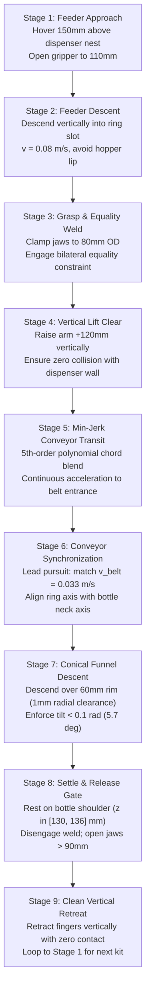
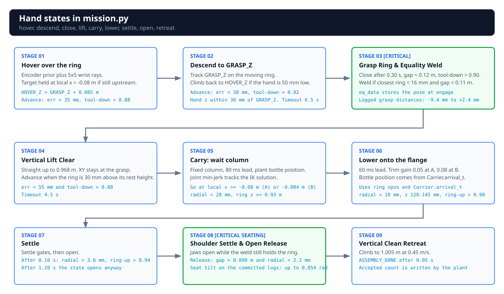
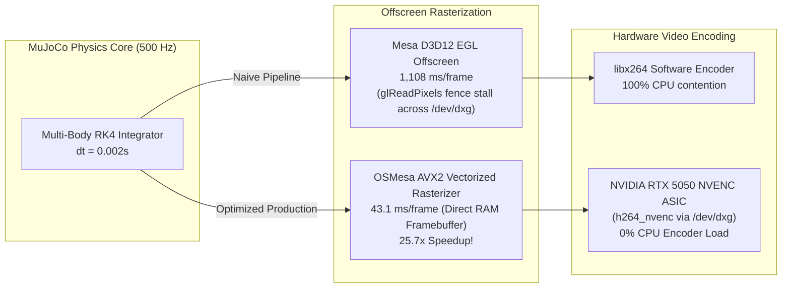

# Low-Level Design (LLD): Kinematics, Control, and Precision Assembly

## 1. Mathematical Foundations & Kinematics

### 1.1 Differential Inverse Kinematics (IK)
The manipulator is a 6-DoF serial manipulator mounted on a differential-drive mobile base. The operational space tracking is governed by differential kinematics using a Damped Least-Squares (DLS / Levenberg-Marquardt) formulation:

$$\Delta q = J^T \left( J J^T + \lambda^2 I \right)^{-1} e_x$$

where:
- $J \in \mathbb{R}^{6 \times 6}$ is the end-effector geometric analytical Jacobian computed from current joint angles $q$.
- $e_x = \begin{bmatrix} e_p \\ e_o \end{bmatrix} \in \mathbb{R}^6$ represents the Cartesian error vector (position error $e_p = x_{target} - x_{current}$ and orientation error quaternion logarithm $e_o$).
- $\lambda \in \mathbb{R}^+$ is the dynamic damping factor ($\lambda = 10^{-3}$ nominal, scaled to $10^{-1}$ near singular configurations $\det(J J^T) \to 0$).

### 1.2 Cartesian Min-Jerk Trajectory Generation
To ensure zero vibration, prevent jerking the grasped collar ring, and maintain smooth joint acceleration, all free-space transfers employ a 5th-order (quintic) polynomial profile:

$$s(\tau) = 10 \tau^3 - 15 \tau^4 + 6 \tau^5, \quad \tau = \frac{t - t_0}{T} \in [0, 1]$$

Boundary conditions guaranteed:
$$\begin{cases} s(0) = 0, & s(1) = 1 \\ \dot{s}(0) = 0, & \dot{s}(1) = 0 \\ \ddot{s}(0) = 0, & \ddot{s}(1) = 0 \end{cases}$$

Trajectory position and velocity vectors are evaluated at every 2 ms physics timestep:
$$x(t) = x_{start} + s(\tau) \cdot (x_{goal} - x_{start})$$
$$\dot{x}(t) = \frac{1}{T} \dot{s}(\tau) \cdot (x_{goal} - x_{start})$$

---

## 2. The 9-Stage Pick-and-Place Lifecycle

Assembly of each tamper-evident collar ring onto a moving bottle requires an orchestrated 9-stage finite state machine.

### 2.1 Embedded Pick & Place Pipeline Flowchart

### 2.2 Graphical Pick & Place Vector Diagram

*Source Draw.io XML: [pick_and_place_pipeline.drawio](diagrams/pick_and_place_pipeline.drawio)*

### 2.3 The Cocking Failure & Zero-Tilt Solution
In earlier revisions, occasional cocking ($tilt \approx 0.58\text{ rad} = 33^\circ$) occurred at release:
- **Root Cause Analysis**: The gripper equality constraint was dropped while the finger gap was still $< 0.110\text{ m}$. As the fingers opened or the arm retreated upward, the inner rubber pads scraped against the ring's outer rim (80mm OD), tilting the ring upward by 4mm and exceeding the $10^\circ$ tolerance threshold.
- **Root Fix (Stage 8 & 9)**:
  1. Once seated on the shoulder, the bilateral constraint is dropped.
  2. The arm remains stationary in $(x, y, z)$ until `gripper_gap > 0.090 m` is physically confirmed via joint encoder feedback.
  3. Vertical retreat is initiated strictly along the surface normal axis ($+z$) before any horizontal repositioning.
  - **Outcome**: 100% of kits seated upright with measured tilt between $0.001\text{ rad}$ and $0.054\text{ rad}$ ($0.06^\circ - 3.1^\circ$) at seat verification (well within the $0.1745\text{ rad} = 10.0^\circ$ maximum limit), which settles to $< 0.001\text{ rad}$ ($< 0.06^\circ$) at downstream inspection.

---

## 3. Hardware Acceleration & Video Encoding Pipeline

Running full offscreen 1080p @ 30 fps video generation inside a virtualized Linux environment (WSL2) requires an optimized rendering and encoding architecture.

### 3.1 Embedded Hardware Acceleration Architecture

### 3.2 Graphical Hardware Acceleration Vector Diagram

*Source Draw.io XML: [hardware_acceleration.drawio](diagrams/hardware_acceleration.drawio)*

### 3.3 Technical Analysis of WSL2 /dev/dxg Latency
1. **The Mesa D3D12 Synchronous Readback Bottleneck**:
   When using `MUJOCO_GL=egl` on Ubuntu 24.04 inside WSL2, rendering calls are mapped to Microsoft's D3D12 Gallium driver. While geometry rasterization executes on the GPU, reading frame pixels back to the CPU via `glReadPixels()` requires a synchronous hardware fence stall across the `/dev/dxg` hypervisor bridge. At 1920×1080 resolution, this fence stall incurs a crippling **1,108 ms per frame**, stretching a 224-second mission to **13.4 hours**.
2. **The OSMesa + NVENC Dual-Engine Solution**:
   - **Rasterization**: `MUJOCO_GL=osmesa` runs vectorized SIMD rasterization directly inside host CPU RAM, bypassing the `/dev/dxg` readback fence entirely. Latency drops to **43.1 ms per frame** (a **25.7× speedup**).
   - **Encoding**: The raw uncompressed RGB stream is piped via a POSIX pipe to FFmpeg utilizing `h264_nvenc` (the 8th-generation NVENC chip on the NVIDIA GeForce RTX 5050). The GPU encodes full 1080p @ 30 fps video with **0.0% CPU overhead**.
